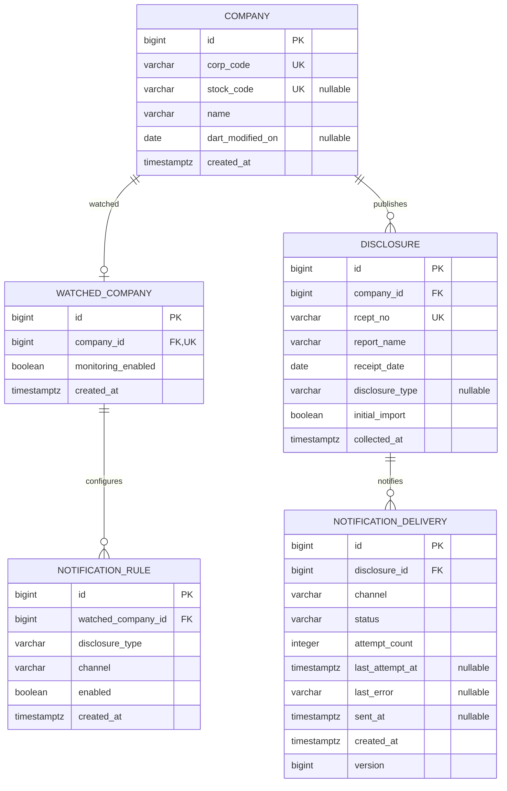

# Phase 1B — 도메인·DB 설계

단일 사용자의 기업 관심 목록과 공시·알림 상태를 5개 테이블로 관리한다.
공시 수집, 조건 매칭, 발송 worker, SMTP/OpenDART 연동은 이번 범위에 포함하지 않는다.
계획서의 요구사항과 충돌하는 변경은 없다.

## ERD



## 식별자와 공시 분류

- `Company.corpCode`: OpenDART 고유번호, 숫자 8자리 문자열. 종목코드로 대체하지 않는다.
- `Company.stockCode`: nullable 6자리 문자열. 비상장·미제공 값은 `NULL`, 빈 문자열도 생성자에서 `NULL`로 정규화한다.
  DB는 영문 대문자·숫자를 허용한다. 두 코드 모두 선행 0을 보존한다.
  `dartModifiedOn`은 고유번호 매핑 파일의 수정일을 보관할 수 있는 nullable 날짜다.
- `Disclosure.rceptNo`: 숫자 14자리 문자열, 전체 DB에서 유일하다. 기업이 달라도 같은 접수번호를 다시 저장할 수 없다.
- 정정공시는 다른 접수번호의 독립 공시로 저장할 수 있다. 보고서명이 같아도 중복으로 취급하지 않는다.
  정정 원본 추적과 자동 판별은 수집 기능 단계에서 검토한다.
- `DisclosureType`은 OpenDART 대분류 A~J를 명시적으로 매핑한다. DB에는 enum **이름**을 저장한다.
  A 정기공시, B 주요사항보고, C 발행공시, D 지분공시, E 기타공시,
  F 외부감사관련, G 펀드공시, H 자산유동화, I 거래소공시, J 공정위공시다.
- 공시검색의 목록 응답 자체에는 대분류 필드가 없으므로 공시의 `disclosureType`은 미확인 시 `NULL`을 허용한다.
  `OTHER`로 임의 분류하거나 보고서명만으로 유형을 추정하지 않는다. 실제 수집 단계에서 유형별 검색 등의 분류 방법을 정해야 한다.
  알림 조건의 유형은 반드시 지정한다. 알 수 없는 유형의 공시는 유형별 알림 대상으로 자동 간주하지 않는다.

공식 필드 근거: [공시검색 가이드](https://opendart.fss.or.kr/guide/detail.do?apiGrpCd=DS001&apiId=2019001),
[고유번호 가이드](https://opendart.fss.or.kr/guide/detail.do?apiGrpCd=DS001&apiId=2019018).
이는 스키마 설계를 위한 문서 확인이며 외부 API를 호출하는 코드는 추가하지 않았다.

## 관계·제약조건

| 테이블 | UNIQUE | 주요 제약 |
| --- | --- | --- |
| `company` | `corp_code`, `stock_code` | 코드 형식, 필수 기업명, nullable 종목코드는 여러 행에서 허용 |
| `watched_company` | `company_id` | 필수 기업 FK, 기업당 관심 등록 1개 |
| `disclosure` | `rcept_no` | 필수 기업 FK·보고서명·접수일·수집일·최초 수집 구분, 코드/유형 CHECK |
| `notification_rule` | `(watched_company_id, disclosure_type, channel)` | 필수 관심 기업 FK, 알려진 유형·채널만 허용 |
| `notification_delivery` | `(disclosure_id, channel)` | 필수 공시 FK, 상태·시도 횟수·시각·오류의 일관성 CHECK |

모든 PK는 identity `BIGINT`이며 FK는 단방향 JPA 연관관계다. Enum은 ordinal로 저장하지 않는다.
관심 등록 삭제 시 해당 조건만 DB `ON DELETE CASCADE`로 삭제한다.
Repository의 `deleteByCompanyId`는 명시적 bulk delete로 DB cascade를 사용하고 영속성 컨텍스트를 비운다.
후속 서비스는 이 삭제 메서드를 사용해야 한다. 조건 Entity가 이미 로딩된 컨텍스트에서 일반 `delete`를 사용하면
메모리에 남은 참조와 DB cascade 사이에 불일치가 생길 수 있다. bulk delete 이후 기존 Entity 참조는 detached 상태다.
기업→공시, 공시→발송 이력은 삭제 전파하지 않고 참조 중인 부모 삭제를 DB가 거부한다.
관심 목록에서 기업을 삭제하거나 재등록해도 공시·발송 이력과 발송 중복 방지 키는 유지된다.
사용자 테이블과 조건-발송 이력 FK는 두지 않는다. 단일 사용자 MVP에서 한 공시·채널에 여러 조건이 매칭되어도 발송 이력은 1개다.

기본 인덱스는 UNIQUE 인덱스 외에 기업별 공시 최신순 조회 `(company_id, receipt_date DESC, id DESC)`,
발송 상태별 조회 `(status, created_at)`만 둔다. 관심 기업별 조건 조회에는 복합 UNIQUE 인덱스의 선두 컬럼을 사용한다.

## 알림 상태와 이력

```text
PENDING → SENDING → SENT (종료)
              └→ FAILED → SENDING (재시도)
```

- `beginAttempt()`: PENDING/FAILED만 허용, 시도 횟수 증가·최근 시도 시각 기록·이전 오류 제거.
- `markFailed(error)`: SENDING만 허용, 실패 원인을 최대 2,000자로 기록.
- `markSent()`: SENDING만 허용, 성공 시각 기록. SENT에는 다시 시도하거나 실패 결과를 덮어쓸 수 없다.
- `initialImport=true`인 공시의 발송 이력 생성은 도메인 생성자에서 거부한다.
  수집 당시 플래그는 JPA 업데이트에서 제외한다. 이 교차 테이블 규칙은 SQL FK/CHECK로 강제하지 않으므로
  후속 수집/알림 서비스도 해당 규칙을 사용해야 하며 직접 SQL 삽입으로 우회하지 않아야 한다.
- 이력 1행은 **공시·채널별 논리적 발송 결과**다. 재시도는 같은 행의 횟수와 최근 결과를 갱신한다.
  과거 모든 시도별 오류·시각을 보존하는 상세 감사 로그는 구현하지 않는다.
- `@Version`은 동시 갱신 시 오래된 상태의 덮어쓰기를 거부한다. 후속 worker는 발송 전 SENDING 전이를 커밋한 뒤
  외부 발송을 실행해야 한다. SMTP 성공 직후 DB 저장 실패 등의 상황에서 외부 발송까지 exactly-once를 보장하는 구조는 아니다.
  SENDING 상태의 장애 복구, 재시도 정책·조건 매칭·수신 주소·오류 메시지의 민감정보 제거는 발송 기능 구현 단계의 범위다.
- 채널은 현재 `EMAIL`만 있다. 향후 enum·DB CHECK 마이그레이션·발송 구현체를 추가하면 채널별 이력을 독립 관리할 수 있다.

## 스키마 적용과 테스트

`V1__create_domain_tables.sql`을 Flyway가 JPA 초기화 전에 실행하고 Hibernate는 `ddl-auto=validate`로 매핑을 검증한다.
DDL은 마이그레이션 한 곳에서 관리하며 `update`, `create-drop`, `schema.sql`을 혼용하지 않는다.
최초 실행은 기존 Phase 1A의 빈 PostgreSQL DB에 테이블과 Flyway 이력을 추가한다. 기존 테이블·데이터를 삭제하지 않는다.
동명 테이블이 있는 별도 DB에는 자동 baseline을 하지 않으며 수동 확인이 필요하다.
기존 V1을 적용한 뒤 스키마를 바꿀 때는 새 버전 SQL을 추가한다.

`DomainPersistenceTests`는 실행마다 `dw_test_<UUID>` 임시 스키마에 동일 마이그레이션을 적용한다.
각 테스트 트랜잭션은 rollback하고, 종료 시 이름 패턴을 검사한 뒤 해당 테스트 소유 스키마만 제거한다.
테스트 계정에는 스키마 생성·삭제 권한이 필요하다. 개발 데이터의 truncate/drop이나 테스트용 비밀번호 생성은 하지 않는다.
기존 `PostgresApplicationTests`는 실제 앱 설정으로 개발 스키마의 마이그레이션과 HTTP 동작을 검증한다.

```powershell
.\gradlew.bat clean build
docker compose up -d --wait postgres
.\gradlew.bat integrationTest
```

실행 검증 결과 (2026-10-24, Java 21 / PostgreSQL 17.11):

- `clean build integrationTest` 첫 실행에서 삭제 관련 3개 테스트 실패를 확인하고 삭제 방식·검증 대상을 수정했다.
- 수정 후 `build integrationTest` 성공: 기본·도메인 테스트 16개, 실제 PostgreSQL 통합 테스트 30개, 실패·오류·생략 0개.
- Flyway 11.7.2의 V1 개발 DB 적용 성공과 Hibernate 스키마 검증을 확인했다.
- DB 메타데이터 조회로 `dw_test_` 임시 스키마가 0개임을 확인했다.
- `git diff --check` 통과. API 연동·메일 발송·Git 커밋·Push는 수행하지 않았다.
